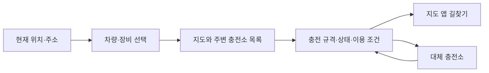

<p align="left"></p>

# 갈 만한 충전소를 고르는 몇 초

PlugPass는 전기차 운전자가 **차량에 맞는 주변 충전소를 찾고, 상태와 이용 조건을 확인한 뒤 길찾기로 이어지는 웹앱**입니다. 가까운 곳에 도착했지만 충전 규격이 맞지 않거나 출입이 제한되는 헛걸음을 줄이는 데 집중합니다.

[웹앱 열기](https://plugpass.duckdns.org/app/index.html#/stations)

## 이렇게 사용합니다

1. **위치를 고릅니다.** 현재 위치를 사용하거나 주소·장소를 검색합니다. 지도에서 이동한 지역을 다시 검색할 수도 있습니다.
2. **차량과 장비를 선택합니다.** 차량의 연결 규격과 이번에 사용할 어댑터를 반영합니다. 목록에 없는 차량은 충전구를 직접 확인해 선택합니다.
3. **충전소를 비교합니다.** 지도와 목록에서 직선거리, 이용 가능한 대수, 충전기별 상태를 확인합니다.
4. **이용 조건을 확인하고 출발합니다.** 상세에서 연결 규격·운영 시간·출입 조건을 확인한 뒤 지도 앱으로 길찾기를 이어갑니다. 이용하기 어려우면 같은 조건의 대체 충전소를 살펴봅니다.



검색 조건은 URL에 담겨 상세와 대체 후보를 다녀와도 유지됩니다. 지도 배경이나 GPS에 문제가 생겨도 검색창과 목록을 유지합니다. 주소 검색 서비스까지 사용할 수 없으면 별도 오류를 안내합니다.

## 상태를 읽는 방법

| 표시 | 의미 |
| --- | --- |
| 이용 가능 | 공급자가 이용 가능한 상태로 전달한 충전기 |
| 사용 중 | 공급자가 충전 중으로 전달한 충전기 |
| 이용 불가·상태 확인 불가 | 사용하기 어렵거나 상태 확인이 필요한 충전기 |
| 정보 갱신 지연·출발 전 확인 | 전체 수집 작업이 지연되어 저장된 정보를 확인해야 하는 상황 |

**이용 가능 표시는 도착 시 빈자리를 보장하지 않습니다.** 현장 확인 시각이 제공되지 않을 수 있고, 수집 성공은 현장 상태를 직접 확인했다는 뜻이 아닙니다. 공급자의 상태 변경 일시는 시간대가 확인되지 않아 ‘몇 분 전’으로 환산하지 않습니다. 표준 시각은 한국 시간으로 표시합니다.

충전소의 운영 시간과 출입 조건, 차량·어댑터의 실제 호환 여부를 출발 전에 확인하세요. 거리는 주행거리가 아닌 직선거리입니다. 길찾기는 외부 지도 서비스에 연결하며 앱의 설치·실행 여부를 탐지하거나 충전 자리를 예약하지 않습니다.

## 프로젝트 구성

| 영역 | 기술과 역할 |
| --- | --- |
| 백엔드 | Java 25 · Spring Boot — 수집, 검색, 상세, 대체 후보 API |
| 저장 | JPA · MySQL 8.4(운영) / H2(개발·기존 테스트) |
| 웹 | Vue · TypeScript — 위치·지도·목록·상세 흐름 |
| API 문서 | Spring REST Docs — 검증한 요청과 응답으로 문서 생성 |


도메인은 상태와 불변식을, 서비스는 유스케이스와 트랜잭션을, 컨트롤러는 HTTP 변환을 맡습니다. 프런트는 API 검증·비동기 상태·화면 표현을 나눕니다. 공공 API의 원본 값은 API 계약에 보존하고 운전자 화면에는 해석된 정보를 제공합니다.

## 로컬에서 실행하기

필요 환경: **JDK 25, Node 26.7.0, Python 3**. MySQL 통합 검증에는 Docker가 필요합니다.

카카오 JavaScript 키를 `KAKAO_JS_KEY`로 안전하게 주입한 셸에서 실행합니다. 브라우저용 키에는 카카오 개발자 설정의 허용 도메인이 필요합니다. 서버용 주소 검색 키 `KAKAO_LOCAL_REST_API_KEY`와 공공 데이터 키는 프런트에 넣지 않습니다.

```bash
export VITE_KAKAO_JS_KEY="$KAKAO_JS_KEY"
./gradlew clean build
java -jar build/libs/plugpass-0.0.1-SNAPSHOT.jar
```

- 웹앱: <http://localhost:8080/app/index.html#/stations>
- API 문서: <http://localhost:8080/docs/index.html>
- 상태 확인: <http://localhost:8080/actuator/health>

기본 개발 설정은 수집이 꺼져 있어 빈 DB로 시작합니다. H2 메모리 DB는 서버가 종료되면 사라집니다. 실제 API 수집과 MySQL 운영 설정은 [운영 가이드](docs/operations.md), 개발 서버와 프런트 명령은 [프런트 가이드](frontend/README.md)를 참고하세요.

실제 공공 데이터 키 없이 합성 공급자→H2→HTTP→화면 흐름을 살펴보려면:

```bash
bash scripts/frontend-e2e.sh --serve
```

이 데모의 충전소와 주소 후보는 검증용 합성 데이터입니다. 실제 지역의 현재 충전 현황으로 해석하지 않습니다.

## 검증하기

```bash
./gradlew test                         # 백엔드 동작·저장·HTTP 계약
npm --prefix frontend run test:unit   # 프런트 동작
npm --prefix frontend run type-check
npm --prefix frontend run lint
bash scripts/verify.sh                # 개발/JAR 브라우저·실제 MySQL까지 공용 검증
```

최초 브라우저 설치는 `cd frontend && npx playwright install chromium`으로 진행합니다. 로컬 E2E는 현재 cmux의 보조 터미널에서 로그를 보이며 headed로 실행하고, CI는 headless로 실행합니다. 타입·lint·브라우저 경고·실패·skip·테스트 0개를 검증 성공으로 처리하지 않습니다.

자동 검증과 실기기 검증은 구분합니다. iPhone Safari의 실제 지도 터치·글자 확대·외부 앱 전환은 실기기 확인이 필요합니다. 자세한 현재 범위와 근거는 [기능 지도](docs/feature-map.md), [개편 실행 기록](docs/visual-redesign-progress.md), [검증 스킬](.agents/skills/verify-plugpass/SKILL.md)에 있습니다.

## 더 알아보기

- [API 데이터 계약](docs/data-contract.md) · [공식 기술 자료](docs/official-stack-guide.md)
- [설계와 개발 계획](plan.md) · [작업 현황](tasks.md)
- [작은 PR 전달 절차](docs/delivery-workflow.md) · [프로젝트 개발 규칙](AGENTS.md)

글꼴은 Pretendard Variable 1.3.9를 자체 제공합니다. [SIL Open Font License](frontend/src/shared/assets/fonts/LICENSE)를 함께 포함합니다.
