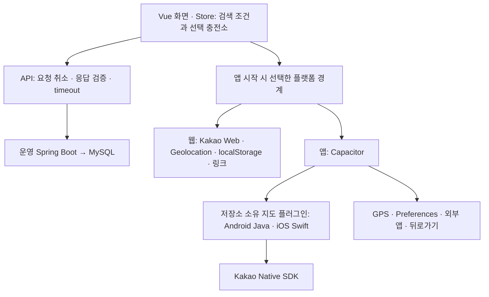

# PlugPass Android·iOS 실기기 앱 계획

상태: 진행 중. 사용자 승인 계획(2026-10-15)이 요구사항의 기준이다. 진행·실행 근거는 [tasks.md](tasks.md)에 기록한다. 기존 [프로젝트 계획](../../plan.md), [기능 지도](../feature-map.md), [전달 절차](../delivery-workflow.md)를 재사용한다.

**우선순위 변경(2026-10-15):** 사용자가 현재 Android 폰이 없으므로 iOS 먼저 진행하도록 지시했다. iPhone 설치·지도·사용 흐름을 우선 검증하고 Android 실기기는 대기로 둔다. 양쪽 완료 기준은 유지하되 Android 기기 부재가 독립적인 iOS 개발을 막지 않도록 플랫폼별 관문을 추적한다.

## 목표와 완료 기준

Vue 화면·업무 로직을 Capacitor 8 앱에 포함하고 Android·iPhone에서 운영 서버 `https://plugpass.duckdns.org`의 실데이터로 차량 선택 → 위치/주소 검색 → 지도·목록 → 상세 → 대체 후보 → 길찾기 → 앱 복귀를 사용한다. 두 실기기의 전체 흐름, 기존 웹 회귀, PR·CI·실제 병합 근거가 모두 있어야 전체 완료다. APK 생성이나 브라우저 mock만으로 실기기 완료를 표시하지 않는다.

- 개발 식별자 `org.duckdns.plugpass.dev`, 표시 이름 `PlugPass`.
- Android 개발 APK와 iOS 무료 Personal Team 직접 설치. iOS 무료 서명 만료 후 재설치 안내 포함.
- 스토어/TestFlight·회원가입·푸시·백그라운드 위치·오프라인 충전소 DB는 범위 밖.
- 기본 지원 하한은 Capacitor 8의 iOS 15·Android 7이며 실제 지원 판정은 확인한 기기·OS에 한정한다. 카카오 SDK가 더 높은 하한을 요구하면 공식 근거와 함께 갱신한다.

## 책임과 데이터 흐름

화면은 사용자 흐름과 선택 상태를 소유한다. 기기 모듈은 권한·저장·SDK 수명·외부 앱 실행만 소유한다. 화면마다 플랫폼 조건문을 추가하지 않는다. 지도 숫자 확대 단계를 플랫폼 간 같은 값으로 취급하지 않는다.

## 변경 계약

| 경계 | 결정과 실패 조건 |
| --- | --- |
| 빌드 | `frontend/` 공유. 웹 `/app/`·`dist`, 앱 상대 자산·`dist-native`. HTML/JS/CSS를 앱에 묶고 `server.url` 원격 사이트 포장은 금지한다. |
| API | 웹 `/api/v1` 유지. 앱은 운영 HTTPS 절대 주소. 기존 DTO·DB 스키마 유지. |
| 주소 | 웹 Web SDK, 앱 `/api/v1/places`. REST 비밀 키는 서버 전용. |
| CORS | `/api/v1/**` 조회 요청에만 `capacitor://localhost`, `https://localhost`. 임의 origin·`null`·와일드카드 금지. |
| 지도 | 비동기 생성·마커 갱신·선택·이동·영역·확대/축소·종료. 준비/실패/선택/이동 시작·완료와 실제 영역 이벤트. |
| 지도 배치 | DOM 지도 자리와 native view의 위치/잘림/가시성을 동기화. 스크롤·화면 변경·키보드·페이지 이탈에 대응. 앱 지도 조작 버튼은 native 사각형 바깥. |
| 위치 | 권한·위치 서비스·10초 timeout 구분. 늦은 응답이 사용자 선택을 덮지 않음. 복귀만으로 재요청 금지. |
| 저장 | 기존 차량/어댑터 규칙과 형식 유지. Preferences 초기 읽기 완료 후 자동 검색 판단. 손상값·I/O 실패 처리. 웹 저장값 자동 이전 가정 금지. |
| 길찾기 | Android ACTION_VIEW + geo, OS 선택창. iOS kakaomap scheme, 실패 시 웹/설치 버튼. 앱에서는 웹 자동 스토어 이동 타이머 금지. |
| 뒤로/복귀 | 열린 패널 → 이전 화면 → 루트 배경 이동. 검색 조건·선택 충전소 보존. |

## 순차 구현과 검증 관문

1. **N01 앱 기반·설치 경로:** 정확한 Capacitor/플러그인 버전 고정, 웹/앱 빌드 분리, 두 native 프로젝트, JDK 분리, 빌드 명령, 두 기기에 묶음 자산 로드. 기능 전체 완료 아님.
2. **N02 native 지도:** 공통 비동기 계약과 각 SDK 어댑터, 배치·잘림·수명·오류/재시도. 두 기기의 실제 지도 → 이동/확대 → 마커 → 스크롤 → 상세/복귀가 다음 기능 연결의 관문이다.
3. **N03 운영 API·주소:** 앱 API 주소, 엄격한 CORS, REST 키 운영 설정 확인. 서버 변경 검증·배포 후 실제 주소 선택 → 지도 이동 → 충전소 검색.
4. **N04 기기 기능:** GPS·Preferences·외부 지도·뒤로가기·복귀, 비동기 역전/실패 회귀.
5. **N05 전달:** safe area·키보드·글자 확대·44px 터치, native CI, APK·iOS 설치/재설치, 실기기 기록, 기존 웹/JAR/MySQL 회귀, 작은 PR·CI·병합.

각 단위는 작은 관찰 동작별 Red(실제 assertion 실패) → 최소 Green → 대상·전체 회귀 → 필요할 때 Refactor → 검증 → 전달 순서다. 환경·컴파일 오류를 기능 Red로 기록하지 않는다. 외부 선행 조건이 막히면 해당 항목을 미확인으로 남기고 독립적인 준비만 계속한다. 지도 실기기 관문을 mock 통과로 대체하지 않는다.

## 검증 매트릭스

| 범주 | 반드시 확인할 관찰 |
| --- | --- |
| 정상 | 차량 → GPS/주소 → 실제 지도/목록 → 상세 → 대체 후보 → 길찾기 → 복귀 |
| 위치 실패 | 최초 거부·설정 변경 후 재시도·서비스 꺼짐·timeout에서 잘못된 검색 없음 |
| 지도 | 실제 인증/배경/마커/영역, 스크롤·키보드·복귀 후 위치와 터치 일치 |
| 비동기 | 늦은 GPS·주소·종료된 지도 이벤트가 현재 선택/결과를 변경하지 않음 |
| 외부 앱 | 설치·미설치·실행 실패·복귀, 올바른 목적지와 검색 조건 유지 |
| 저장/네트워크 | 재시작 차량 보존·손상 복구·저장 실패·오프라인/서버 오류/재시도 |
| 웹 회귀 | 기존 검색·지도·상세·길찾기, 개발 모드 경고 감시, 배포 JAR·실제 MySQL |

로컬 러너·서버의 명령과 로그는 현재 호출 cmux workspace의 보조 pane에 표시한다. 사용자 후속 요청에 따라 브라우저 검증은 headless로 실행한다. native 빌드·설치도 CLI를 사용하되 최초 Apple 계정 인증/Team 선택과 iPhone 신뢰 승인은 사용자가 처리한다. native 화면은 실기기·에뮬레이터·시뮬레이터를 각각 기록한다. 서명·비밀값은 저장소/공개 로그에 넣지 않는다.

## 작업 시작 시 확인한 전제

- 기준 `bb3f106`, 깨끗한 main. 작업 브랜치 `feat/native-app-foundation`, worktree `/private/tmp/plugpass-native-app`.
- 사용자는 Android·iPhone 연결 가능. 신뢰/개발자 모드/Apple 로그인/카카오 등록은 단계별 안내 필요.
- Xcode 전체 앱·Android SDK/adb가 아직 없음. Apple 계정·약관 동의는 사용자가 직접 처리한다.
- Java25 백엔드 유지, Android는 Java21 경계로 분리. 기존 Vue3.5.43·TypeScript6.0.3 유지.
- 현재 호출 cmux `workspace:1000090002`, 호출 `surface:1000090006`, 새 검증 `surface:1000090016`.

## 사전 인터페이스 검토와 판단 기록

| 공급 → 소비 | 확인한 현재 상태와 필요한 변화 |
| --- | --- |
| N01 빌드 → N02 플러그인 | 웹 Vite 설정은 정적 `/app/`. 앱 산출물을 별도 설정·폴더로 분리해 기존 웹에 영향 없도록 한다. |
| N02 지도 → N04 위치/복귀 | 현재 StationMapSession은 동기 반환. 비동기 명령·수명 토큰이 필요하며 선택 상태는 Vue에 유지한다. |
| N03 API → 주소/검색 | Axios는 `/api/v1` 고정, Web SDK 키가 있으면 주소가 SDK를 선택. 앱 경계에서 절대 API와 REST 검색을 선택해야 한다. |
| N04 저장 → 자동 검색 | 현재 localStorage 읽기는 동기. 앱 초기화 완료를 명시해야 저장 차량을 읽기 전 GPS/검색이 시작되지 않는다. |

Ruling: 사용자 후속 요청에 따라 이 폴더의 별도 plan.md/tasks.md를 유일한 모바일 진행 원장으로 사용한다. 루트 문서는 연결만 추가한다. 이유: 기존 웹 작업의 완료 상태와 모바일 미확인을 섞지 않는다.

Ruling: iOS 우선 지시로 각 플랫폼의 실제 지도 관문을 해당 플랫폼의 후속 기능 연결 조건으로 적용한다. Android 전체 검증은 기기 확보 후 이어간다. 두 기기 완료로 오인할 위험은 tasks의 별도 상태와 기기 기록으로 방지한다.
