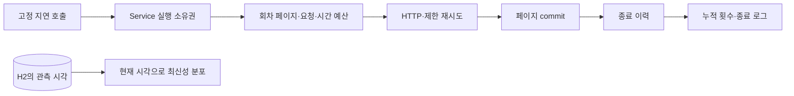

# 수집과 데이터 품질 확인

## MySQL 배포 프로필

운영 DB는 MySQL 8.4 LTS다. 기본 프로필은 개발·기존 회귀용 메모리 H2를 유지한다. 배포 프로필은 DB 주소·암호가 빠지거나 스키마가 맞지 않으면 기동에 실패해야 한다. H2 파일 주소로 대신 실행하지 않는다.

```text
외부 API → 수집 서비스 → 페이지별 transaction → MySQL
웹 요청 → 조회 서비스 → Repository/JPA ──────────┘

기동: Flyway V1… 적용 → Hibernate validate → HTTP 제공
```

DB 관리자가 빈 `plugpass` 스키마와 전용 계정을 먼저 준비한다. 애플리케이션은 DB 서버/계정 자체를 생성하지 않는다. 현재는 같은 datasource 계정으로 Flyway를 실행하므로 업무 DML과 테이블 생성·마이그레이션에 필요한 권한이 있어야 한다. 운영의 계정 분리·백업 정책은 배포 환경에서 정한다.

`.env.example`의 값은 예시이며 Spring이 자동으로 읽지 않는다. 비밀 관리 도구/실행 환경으로 아래 변수를 주입한다. 암호·공공 API 키는 CLI 인자나 Git에 넣지 않는다.

| 변수 | 용도 |
| --- | --- |
| `SPRING_PROFILES_ACTIVE=deployment` | MySQL·Flyway·스키마 검사 활성화 |
| `PLUGPASS_DATABASE_URL` | `jdbc:mysql://<host>:3306/plugpass?sslMode=VERIFY_IDENTITY` |
| `PLUGPASS_DATABASE_USERNAME` | DB 계정, 기본 `plugpass` |
| `PLUGPASS_DATABASE_PASSWORD` | 필수 DB 암호 |
| `MANAGEMENT_SERVER_PORT` | 기본8081, 외부에 공개하지 않는 관리 포트 |

서버 인증서의 CA·호스트명에 맞는 TLS 구성을 사용한다. `scripts/mysql_environment.py`의 `sslMode=DISABLED`·`allowPublicKeyRetrieval=true`는 임의 인증정보를 사용하는 **loopback 전용 테스트 컨테이너** 설정이다. 운영 URL 예시에는 적용하지 않는다.

환경 주입 후 `java -jar build/libs/plugpass-0.0.1-SNAPSHOT.jar`로 실행한다. Connector/J는 UTC 세션을 사용하고 Hibernate의 JDBC 시각도 UTC로 고정한다. 스키마의 `DATETIME(6)`은 마이크로초까지 보존한다. 공급자 원문 시각의 시간대 추정과는 다른 문제다.

Flyway `db/migration/mysql/V1__initial_schema.sql`이 station·charger·sync_run과 unique/FK를 만든다. utf8mb4로 한글·이모지를 저장하고 `utf8mb4_0900_bin`으로 식별자의 대소문자·끝 공백을 구분한다. Hibernate는 `validate`만 수행한다. 배포된 V1을 고쳐 쓰지 말고 후속 `V2__...sql`을 추가한다. 기존 데이터가 있는 비관리 스키마를 자동 baseline하거나 H2 데이터를 자동 이관하지 않는다. 이관 대상이 있으면 별도 export/import·대조 계획이 필요하다.

공용 `bash scripts/verify.sh`는 Docker를 요구한다. `python3 scripts/verify-mysql.py --tests-only`는 격리된 MySQL에 저장 계약을 검증한다. 패키징 후 `python3 scripts/verify-mysql.py`는 합성 공급자 수집→MySQL→검색/상세/추천→앱 종료·DB 재시작→재수집 없는 운영 JAR 조회와 실제 브라우저 흐름까지 확인한다. 실행할 때마다 임의 컨테이너·인증정보·포트를 사용하고 종료 시 자기 컨테이너/임시 데이터만 삭제한다. 기존 DB와 연결하지 않는다.

화면을 직접 조작하려면 현재 cmux 보조 pane에서 `python3 scripts/verify-mysql.py --serve`를 실행한다. 출력되는 `MYSQL_BROWSER_READY` URL을 같은 workspace의 브라우저에 연다. 종료는 해당 pane의 Ctrl+C이며 pane은 유지한다. `build/verification/mysql/`의 JSON/서버 로그, `build/test-results/mysqlTest/`, `frontend/test-results/mysql.json`을 확인한다. 수집 완료·최신성·서버 health는 아래 설명처럼 서로 다른 지표다.

현재 전환 계획과 실제 실행 근거는 [MySQL 계획](mysql-deployment-plan.md)·[작업 목록](../tasks.md)을 따른다. 실제 운영 DB 생성·백업 복원·전체 실공공 데이터 수집·공개 배포 완료를 로컬 검증으로 대신하지 않는다.

`GET /actuator/health`의 `UP`은 서버와 기본 구성의 상태다. 충전소 관측 시각의 최신성이나 전체 수집 성공을 뜻하지 않는다.
수집은 기본 비활성화다. 실제 계정 한도·검증 지역·페이지 수를 확인한 뒤 인증키와 `PLUGPASS_INGESTION_ENABLED=true`를 외부 환경에 설정한다. 키를 명령 인자·로그·저장소에 쓰지 않는다.



## 로컬 확인

전체 검증은 `bash scripts/verify.sh`다. 실제 JAR 확인용 서버는 아래처럼 실행한다. 이 설정은 해당 프로세스에서만 지표 HTTP를 노출한다. 기본 노출은 health이며 env는 계속404다.

```bash
java -jar build/libs/plugpass-0.0.1-SNAPSHOT.jar --server.address=127.0.0.1 --server.port=18080 --management.endpoints.web.exposure.include=health,metrics
curl -s http://127.0.0.1:18080/actuator/health
curl -s http://127.0.0.1:18080/actuator/metrics
curl -s 'http://127.0.0.1:18080/actuator/metrics/plugpass.ingestion.has.success'
curl -s 'http://127.0.0.1:18080/actuator/metrics/plugpass.ingestion.last.success.age'
curl -s 'http://127.0.0.1:18080/actuator/metrics/plugpass.ingestion.runs?tag=outcome:SUCCESS'
curl -s 'http://127.0.0.1:18080/actuator/metrics/plugpass.data.chargers?tag=freshness:STALE'
```

수집되지 않은 서버의 누적 카운터는 아직 없을 수 있다. has.success=0은 전체 성공 이력이 없다는 뜻이며 last.success.age는 NaN이다. 0초 경과와 미확인을 구분한다.

| 지표 | 단위·태그 | 의미 |
| --- | --- | --- |
| plugpass.ingestion.runs | 회차, outcome | SUCCESS / PARTIAL_FAILURE / FAILURE 종료 횟수 |
| plugpass.ingestion.records | 입력 건수 | commit된 페이지의 처리 건수 합. 같은 ID의 재수집도 포함하며 DB 고유 충전기 수가 아님 |
| plugpass.ingestion.requests | 요청 횟수 | 재시도를 포함한 실제 client 진입 횟수 |
| plugpass.ingestion.retries | 재요청 횟수 | 실제 시작한 추가 시도 횟수. 예산으로 막힌 대기는 포함하지 않음 |
| plugpass.ingestion.failures | 실패 회차, cause | AUTHENTICATION / RATE_LIMIT / SERVER / CONTRACT / TIMEOUT / TRANSPORT / BUDGET_EXHAUSTED / STORAGE / INTERNAL |
| plugpass.ingestion.has.success | 0 또는1 | 전체 성공 이력 존재 여부 |
| plugpass.ingestion.last.success.age | 초 | 마지막 전체 성공 이후 경과. 실패·부분 실패가 초기화하지 않음 |
| plugpass.data.chargers | 저장 충전기 수, freshness | 조회 가능한 전체 저장 관측의 RECENT / STALE / UNVERIFIED 분포 |

누적 카운터는 프로세스 시작 이후 값이며 재시작하면 초기화된다. 최신성 게이지는 조회 시 DB에서 건수를 계산한다.
RECENT는 관측 시각이 미래가 아니고 maxAge(기본10분) 이하, STALE은 초과, UNVERIFIED는 관측 누락/미래다. 경계10분은 RECENT다.
현재 공급자는 관측 시각을 제공하지 않아 기본적으로 UNVERIFIED다. 수집 성공만으로 RECENT가 되지 않는다.
여러 게이지는 각각 조회하므로 수집 commit과 동시에 읽으면 측정 시점 차이가 있을 수 있다.

## 실패와 복구 해석

- AUTHENTICATION: 키·활용 신청을 확인한다. CONTRACT: XML·필수 필드·페이지·중복·완료 건수를 확인한다. 둘 다 같은 요청을 재시도하지 않는다.
- TIMEOUT / RATE_LIMIT / SERVER / TRANSPORT: 최대 한 번 재시도한다. interrupt는 바로 종료하고 flag를 유지한다. Retry-After가 남은 예산 이상이면 재요청하지 않는다.
- BUDGET_EXHAUSTED: 회차의10페이지/20요청/120초 상한을 확인한다. 상한을 넘기기 위해 설정을 올리는 대신 검증 범위·페이지 크기·계정 한도를 다시 확인한다.
- PARTIAL_FAILURE: 앞서 commit한 페이지는 유지된다. 전체 성공 시각은 갱신하지 않는다. FAILURE도 기존 업무 데이터를 삭제하지 않는다.
- INTERNAL / STORAGE: runId로 종료 로그와 이력을 연결해 원인을 확인한다. 다음 실행 소유권은 해제되며 스케줄러는 다음 회차를 유지한다.

종료 로그에는 runId·outcome·processed·failedPage·failure·requests·retries만 기록한다. 공급자 응답 전체·URL·키·원본 I/O 예외를 출력하지 않는다. 지표 태그에는 충전소/충전기/실행 ID를 넣지 않는다.
중복 호출은 SKIPPED로 즉시 종료하며 새로운 실행 이력·요청·완료 카운터를 만들지 않는다.
H2 메모리 방식은 프로세스 재시작 후 업무 데이터·수집 이력의 복구를 보장하지 않는다.

실제 검증: [3주차 기록](week3-verification.md). fixture 서버의 장애·복구를 검증한 범위이며 실공공 API 인증과 cmux 화면 E2E는 별도 미확인이다.

## 명시적인 일회 수집 (T33/T34)

동일 배포 JAR에 `--spring.main.web-application-type=none --plugpass.ingestion.command.enabled=true --plugpass.ingestion.schedule.enabled=false`를 전달한다. 전체 성공은 종료0, 실패/부분 실패1, 다른 실행이 잠금을 소유하면2다. 인증키는 기존 서버 환경으로만 주입한다. MySQL에서는 `plugpass.ingestion` DB 연결 잠금을 사용하고 외부 요청/페이지 저장 전 소유권을 확인한다. 웹 배포 슬롯의 자동 수집은 계속 끈다.

전국은 `PLUGPASS_PUBLIC_DATA_REGION=ALL`로 zcode를 생략한다. 기본 예산은 기존10페이지/20요청/120초이며 전국 초기 실행에 명시적으로 최대200페이지/300요청/30분을 허용한다. 상한을 넘거나 전체 건수가 맞지 않으면 실패를 기록하고 이전 페이지 commit은 보존한다. 페이지·요청 상한 확장은 계정 쿼터를 자동 확인하는 기능이 아니다. 사용자 확인 한도는 getChargerInfo/getChargerStatus 각각 일일100,000회다.

### 운영 데이터 주기·보존 (2026-10-13)

`plugpass-ingestion.timer`는5분마다 활성 검증 JAR의 auto 모드를 호출한다. 최초/전체 성공24시간 경과/성공10분 공백이면 전체 정보를 재수집하고 그 외에는 최근10분 상태 변경분을 수집한다. 전국 기본정보는 최대200페이지·300요청·30분, 상태는20페이지·40요청·120초이며 일시 실패 재시도는1회다. 단일 실행 잠금과 페이지 commit을 유지한다.

조회 결과의 collection CURRENT/DELAYED/NOT_READY는 수집 작업의 건강 상태다. 현장 관측 시각이나 빈자리 보장이 아니며 기존 충전기 UNVERIFIED를 유지한다. 실패 시 이전 목록·성공 시각을 유지하고 갱신 지연을 안내한다. 데이터/이력 자동 삭제는 없고 공급자의 누락을 폐쇄나 삭제로 추측하지 않는다.

`plugpass-backup.timer`: 매일02:30 KST, 성공한 로컬 백업7일, 격리 MySQL 복원·건수 일치 후 성공 표시. 서버 내 백업과 일회 로컬 사본을 검증했으며 자동 원격 저장소는 미설정이다. 타이머/스크립트와 명령은 [운영 저장소 PR4](https://github.com/seungmin-park/gcp-deployment/pull/4), 실제 건수·해시·한계는 [운영 검증](production-data-verification.md)을 따른다.
