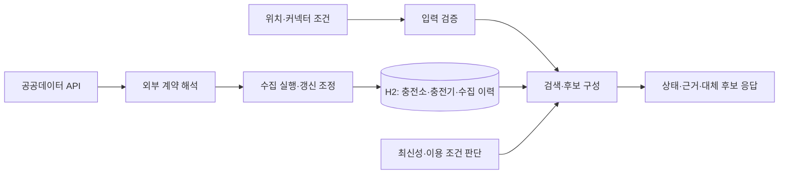

# PlugPass 프로젝트 계획

**목표:** 충전소의 상태·정보 최신성·이용 조건과 대체 후보를 제공하는 백엔드에 목록 중심 반응형 웹앱을 연결하여 전기차 충전소 헛걸음을 줄이는 판단을 돕는다.

**구조:** 하나의 Spring Boot 애플리케이션에서 외부 데이터 수집과 사용자 조회를 분리한다. 운영은 MySQL, 기본 개발·기존 테스트는 H2에 저장하고 조회 요청은 저장된 데이터를 사용한다. 외부 API 장애가 사용자 요청의 즉시 실패로 이어지지 않도록 한다.

**기술:** 현재 백엔드는 Java 25 LTS, Spring Boot 4.1.1, JPA·MySQL(운영)/H2(개발·기존 테스트), Spring REST Docs. 프런트는 Vue3·TypeScript이며 T18~T25의 화면·API 연결·지도·JAR 검증을 완료했다.

**기간:** 기존 백엔드 4~6주 계획에 목록 중심 프런트 8~12작업일을 추가해 전체 6~8주를 예상한다. 4주차 핵심 흐름·성능 기준선 이후 성능 개선·장애 검증, 프런트 순으로 진행한다. 개략 추정이며 확정 날짜는 아니다.

**실행 목록:** [tasks.md](tasks.md). 구현 시 `superpowers:executing-plans`로 작업 하나씩 진행하며, 병렬 에이전트 실행은 별도 사용자 지시 없이 시작하지 않는다. 이 문서는 계획이며 미완료 기능의 구현을 뜻하지 않는다.

## 모바일 실사용 개선 (2026-10-13)

사용자 실사용 피드백을 반영한 [개선 설계·검증 계획](docs/mobile-ux-improvement-plan.md)의 T38~T42를 기능별 PR로 순차 진행한다. 위치 복구·운영 데모 제거 → 결과/주소/지도 → 바로 길찾기 → 이용 조건/시각 → 차량/개인 어댑터 호환 순서다. 현재는 설계 검토 단계이며 구현 완료를 뜻하지 않는다.

## 운영 DB 확정 (2026-10-12)

사용자가 MySQL을 확정하고 배포 준비의 DB 전환을 요청했다. [전환 계획](docs/mysql-deployment-plan.md)과 T26/T27을 순차 진행한다. Flyway 스키마·실제 MySQL 저장/재시작 보존·공용 verify/CI를 구현하며 공개 배포는 별도다. 아래의 초기 H2/실연동 미확인 설명은 해당 단계의 역사적 범위이며 현재 상태는 작업 목록·실행 기록을 따른다.

## CI 보강 — 동작과 구조의 검증 책임 분리 (2026-10-05)

- 목적: 도메인 규칙의 결과는 기존 동작 테스트가 확인하고, 책임·의존성 위치는 구조 검사와 리뷰가 확인한다. HTTP와 업무 동작은 변경하지 않는다.
- 구조: ArchUnit core를 기존 JUnit 실행에 연결한다. REST Controller→Service 계약, 도메인→HTTP/저장 호출 금지, 엔티티 공개 setter 금지, Service 이름/계약과 Service·MVC 테스트 경계를 검사한다. 검사 대상과 리뷰의 한계는 [검증 기준](docs/architecture-guardrails.md)에 기록한다.
- 누락: [필수 테스트 목록](docs/required-test-suites.json)을 실제 JUnit XML과 비교한다. 고정 총건수나 coverage 비율을 강제하지 않는다. 새로운 선택 테스트는 허용하고 기존 필수 suite 삭제·이름 변경은 기능 지도와 함께 검토한다.
- 실행: 검사기의 허용/금지 예제로 Red→Green을 확인하고, 실제 Controller의 임시 위반과 필수 XML 누락을 공용 경로에서 거부하는지 확인한다. 복원 후 `bash scripts/verify.sh`와 원격 CI를 확인한다.
- 제외: 사용자 선택에 따라 JaCoCo를 도입하지 않는다. 동시성·성능·실공급자 검증은 기존 후속 기능 작업의 범위로 유지한다.

## 프런트 검증 기준 확정 (2026-10-05, 구현 전)

사용자 요청에 따라 TypeScript strict·배열/optional·Vue 템플릿 검사, 타입 검사 선행 build, lint 경고 0건, 개발 모드의 `[Vue warn]`·예상 밖 진단·실행 예외 실패를 T18·T23·T24의 필수 기준으로 확정한다. [검사 소유자·실제 거부 확인·한계](docs/frontend-plan.md#101-엄격한-정적-검사와-vue-경고)를 따른다. T18의 타입·lint·단위 실행 경고 검사와 실제 거부 근거는 [실행 기록](docs/frontend-verification.md)에 있다. T23/T24 브라우저·JAR 검증은 남아 있다. T16→T17→T18의 기존 순서와 배포용 JAR 웹앱 확인을 유지한다.

## 1. 확정 사항과 현재 상태

현재 프로젝트의 agent-engineering 적용은 기존 추천 흐름·구조 검사·verify를 재사용한다. [.agents/verification.json](.agents/verification.json)으로 현재 소스와 실행 로그를 연결하고, 전역 읽기 전용 PR 도구로 CI 통과·머지 준비·실제 머지를 구분한다. [적용 범위와 근거](docs/agent-engineering-application.md)를 따른다. 이 적용은 T14 이후 기능·실공공 API 인증·성능 검증을 완료한 것으로 바꾸지 않는다.

| 구분 | 내용 |
| --- | --- |
| 초기 사용자 확정 | 이름은 PlugPass·플러그패스, 기존 백엔드 기간은 4~6주. 프런트 추가 예상은 아래 일정과 구분 |
| 현재 선택 | 서비스 언어는 Java, DB는 H2로 간단히 시작, API 문서는 Spring REST Docs |
| 프런트 범위 확정 (2026-10-05) | 사용자 선택: 목록 중심 반응형 웹앱으로 검색·상세·대체 후보를 먼저 완성하고 지도는 후속 단계. T18 Vue3·TypeScript 기반 도입; T20 실제 검색 연결; 상세·추천은 T21 이후 |
| 구현·검증 완료 | 애플리케이션 기동, health HTTP, JPA 저장·재조회 테스트, 문서 생성·JAR 제공, T02 식별/위치, T03 상태 정규화, T04 업무 저장, T05 외부 HTTP 클라이언트(fixture 검증), T06 페이지 수집/실행 이력, T07 관측 최신성, T08 주변 검색, T09 상세 조회/실제 fixture 연결 검증, T10 근거 있는 추천, T11 중복 방지 스케줄, T12 실행 예산/제한 재시도/다음 회차 복구, T13 수집·품질 지표 |
| 협업 기반 완료 | 작은 PR, 필수 CI, 보호된 main, 자동 squash merge. [PR #1](https://github.com/seungmin-park/PlugPass/pull/1)에서 실제 동작 확인 |
| 4주차 구현·실측 | T14 종합 HTTP 데모, T15 조회 성능 기준선: p95 1425.41ms 목표 미달·오류0%, 생성 데이터 전후 정확성 확인 |
| 후속 작업 | T16~T25는 체크리스트의 완료 근거를 따른다. T25 검색 결과 지도·목록 선택은 Leaflet + OpenStreetMap으로 구현해 main에 반영했다. [범위·검증·병합 근거](docs/t25-verification.md)를 따른다. |
| T01 인증된 계약 재확인 (2026-10-06) | 인천 실응답·식별자/좌표/커넥터/상태/빈 시각·페이지 종료 확인. 마지막/빈 응답의 실제 보고 건수6/0을 요청 용량과 구분하도록 수정했다. 시간대·계정별 한도는 공식 보장 미확인. [실행·전달 근거](docs/t01-live-verification.md) |

T02~T15를 구현·검증하고 main에 반영했다. 4주차 당시 근거는 [체크리스트](tasks.md)와 [실행 기록](docs/week4-verification.md)에 연결했다. 당시 공용 검증은 Java357건·Python14건 실패/오류/skip0과 실제 JAR HTTP·REST Docs 일치를 확인했고, 키와 cmux 접근 제한으로 실공공 인증·화면 E2E를 확인하지 못했다. 이후 화면 검증은 T20~T25, 인증된 공급자 계약은 T01 재개 기록을 따른다. 현재 H2는 메모리 모드이므로 서버 재시작 후 데이터를 보존하지 않는다. 서버가 살아 있다는 health 응답은 충전소 데이터가 최신이라는 뜻이 아니다.

아래 API·객체·작업 분할은 이 목표를 구현하기 위한 설계안이다. 외부 API의 제공 사실과 구분하며, T01에서 확인한 계약과 충돌하면 관련 항목을 함께 수정한다.

## 2. 누구의 어떤 판단을 돕는가

대상은 현재 위치 근처에서 차량에 맞는 충전소를 찾는 운전자다.

1. 위치·검색 반경·커넥터 종류를 입력한다.
2. 주변 충전소의 충전기 상태, 거리, 이용 제한, 데이터 시각을 확인한다.
3. 상태가 오래됐거나 확인되지 않은 경우 그 이유를 확인한다.
4. 첫 후보를 이용하기 어렵다면 같은 조건의 다른 충전소를 확인한다.

제공하는 가치는 **상태와 근거를 함께 설명하는 것**이다. 도착 시점의 빈자리나 충전 성공을 보장하지 않는다. 경로·교통 기반 소요 시간, 예약, 실시간 현장 점유 판단은 범위에 넣지 않는다.

## 3. 첫 완성본의 범위

| 포함 | 완료 모습 |
| --- | --- |
| 공공데이터 공급자 1곳·검증 지역 1곳 | 실제 응답과 익명화한 테스트 fixture로 수집 경로 재현 |
| 충전소·충전기 수집과 갱신 | 같은 데이터를 다시 수집해도 중복되지 않고 최신 유효 상태 유지 |
| 상태 정규화 | 이용 가능·사용 중·이용 불가·알 수 없음으로 변환하고 원본 코드 보존 |
| 데이터 최신성 | 제공자가 관측한 시각과 우리 서버가 수집한 시각을 구분해 표시 |
| 주변 조회·상세 조회 | 위치·반경·커넥터 조건으로 검색하고 충전기별 근거 확인 |
| 대체 후보 | 확인 가능한 최신 이용 가능 후보를 우선 제공하고 제외·불확실 이유 설명 |
| 반복 수집·장애 복구 | 중복 실행 방지, 시간 제한, 제한된 재시도, 실패 후 다음 수집에서 회복 |
| 검증·문서 | REST Docs, 실제 HTTP 검증, 장애 시나리오, 성능 기준선과 재현 절차 |
| 목록 중심 웹앱 | 브라우저 위치·커넥터 선택 → 주변 검색 → 상세·최신성 확인 → 첫 충전소를 제외한 대체 후보, 로딩/빈 결과/오류 구분·모바일/데스크톱 지원 |

첫 완성본에서 제외한다: 로그인·회원·결제·예약, 커뮤니티 제보, 알림 발송, 지도 프런트엔드 전체 구현, 머신러닝 대기 시간 예측, 전국 대규모 수집, 다중 인스턴스 운영, MCP 서버 제공. 추가 저장소·메시지 브로커·캐시는 측정된 필요가 생기기 전에는 도입하지 않는다.

## 4. 데이터 계약과 최신성 원칙

T01에서 공식 활용 가이드와 실제 응답을 확인해 `docs/data-contract.md`에 공급자·API명·공식 URL·확인일·인증 방식·페이지 규칙·요청 한도·이용 조건을 기록한다. 비밀 키를 저장소·fixture·로그에 넣지 않는다. 실데이터 접근이 막히면 fixture 개발과 실연동 미검증 상태를 구분한다.

| 데이터 | 책임과 규칙 |
| --- | --- |
| 식별자 | 공급자·충전소 ID·충전기 ID의 조합으로 충돌과 중복 방지 |
| 위치·커넥터·운영 정보 | 누락·잘못된 좌표·미지원 코드는 추측으로 채우지 않고 오류 또는 미확인 처리 |
| `sourceObservedAt` | 공급자가 상태를 관측한 시각임이 계약에서 확인된 경우에만 사용 |
| `sourceStatusChangedAt` | 마지막 상태 변경 시각이면 별도로 보존. 오래 유지된 상태라는 이유만으로 데이터가 오래됐다고 판단하지 않음 |
| `collectedAt` | 우리 서버가 응답을 받은 시각. 방금 재수집했다는 이유만으로 원본이 최신이라고 판단하지 않음 |
| `lastSuccessfulRunAt` | 수집 범위의 모든 페이지 처리가 성공한 실행에만 갱신 |

최신성은 `RECENT`, `STALE`, `UNVERIFIED`로 표현한다. 신뢰할 수 있는 관측 시각이 없으면 `UNVERIFIED`다. 미래 시각·파싱 불가 시각도 확인 실패 이유를 남긴다. `RECENT`는 관측 시각이 현재보다 미래가 아니고 경과 시간이 설정한 `maxAge` 이하일 때다. `maxAge`는 T01에서 확인한 공급자 갱신 특성과 허용할 지연을 근거로 정한다. 공식 근거 없이 “실시간” 또는 “5분 이내”를 제품 약속으로 고정하지 않는다.

수집 실패가 기존 데이터를 삭제하거나 최신성 시계를 새로 시작하게 해서는 안 된다. 페이지 일부만 성공하면 실행 결과는 부분 실패로 기록한다. 성공한 개별 데이터는 사용할 수 있지만 전체 동기화 성공으로 표시하지 않는다. 응답에서 빠진 충전기를 삭제 처리하는 정책은 첫 완성본에서 적용하지 않는다.

## 5. 객체 책임과 데이터 흐름



| 책임 | 맡는 일 | 맡지 않는 일 |
| --- | --- | --- |
| `Station`, `Charger`, `ChargerId` | 충전소·충전기의 식별·상태·데이터 유효성 | HTTP 호출·응답 JSON 구성 |
| `FreshnessPolicy` | 주입받은 현재 시각과 관측 시각으로 최신성 판단 | 시스템 시각 직접 조회·DB 접근 |
| `PublicDataClient` | 인증·페이지·외부 응답 해석과 정규화 입력 생성 | 추천 순서 결정·DB 트랜잭션 |
| `StationSyncService` | 실행 결과·페이지 처리·중복 없는 저장·순서 역전 방지 | 긴 외부 호출을 DB 트랜잭션 안에서 수행 |
| `StationQueryService` | 저장된 데이터 검색·도메인 판단을 응답으로 조합 | 사용자 요청마다 외부 API 호출 |
| `CandidatePolicy` | 호환성·최신성·거리와 제외 이유에 따라 후보 구성 | 근거 없는 확률 점수·예측 |
| `IngestionBudget`, `RetryingPageFetcher` | 회차의 페이지·요청·시간 상한과 일시 오류 재시도 | 인증/계약 오류 무한 반복·DB 저장 강제 중단 |
| `IngestionMetrics` | 종료 결과 기록과 현재 성공 경과·최신성 관측 | DB 상태 변경·충전 가능 보장 |

기능별 묶음 안에서 역할을 구분한다.

```text
src/main/java/com/plugpass/
  station/        domain/ · repository/
  freshness/      domain/ · config/
  ingestion/      client/ · config/ · domain/ · dto/ · repository/ · service/ · scheduler/ · metrics/
  search/         controller/ · domain/ · dto/ · service/
  recommendation/ controller/ · domain/ · dto/ · service/
  common/         dto/response/ · validation/
  exception/      사용자 정의 예외 · 공통 HTTP 예외 처리
src/test/java/com/plugpass/  같은 기능·역할별 경로, 전체 연결 검증은 integration/
src/test/resources/publicdata/  비밀 정보 없는 외부 응답 fixture
src/docs/asciidoc/index.adoc     테스트에서 생성한 업무 API 문서
```

HTTP DTO는 각 기능의 `dto/request`, `dto/response`에 모은다. T11 스케줄 진입점은 `ingestion/scheduler`, T13 관측은 `ingestion/metrics`에 둔다. 외부 API 계약·저장 매핑·공개 HTTP 계약은 패키지 이동으로 변경하지 않는다.

Service 이름은 유스케이스 인터페이스를 뜻하며 구현은 `Default{ServiceName}`으로 둔다. 테스트 경계·Java 명시적 타입·엔티티 생성·이름과 책임 검토는 [AGENTS.md](AGENTS.md)를 따른다.

객체지향 생활 체조는 [프로젝트 기준](docs/object-calisthenics.md)을 따른다. ID·좌표 등 실제 불변조건이 있는 값에 책임을 부여한다. 규칙을 맞추기 위한 빈 래퍼·불필요한 인터페이스를 늘리지 않는다. 저장 기술 교체가 실제로 필요해질 때 해당 경계를 확장한다.

## 6. API 설계안

| 경로 | 입력 | 응답과 실패 조건 |
| --- | --- | --- |
| `GET /api/v1/stations` | 위도·경도·반경·커넥터·limit | 거리순 주변 충전소, 상태 요약·최신성·이용 제한. 결과 없음은 200과 빈 목록 |
| `GET /api/v1/stations/{stationId}` | 내부 충전소 ID | 충전기별 상태·관측/수집 시각·미확인 이유. 없는 ID는 404 |
| `GET /api/v1/recommendations` | 같은 검색 조건, 선택적 제외 충전소 ID | 우선 후보와 확인이 필요한 후보를 분리하고 reasonCodes 제공 |

초기 입력 제한은 위도 -90~90, 경도 -180~180, 반경 100~10,000m, limit 1~50(기본 20)으로 제안한다. 유효하지 않은 입력은 400과 일관된 오류 응답이다. 위도·경도·반경·커넥터는 필수다. 시간은 UTC offset을 포함한 ISO 8601로 응답한다. 제공자 원본 시각은 계약의 시간대를 확인해 변환한다.

우선 후보는 호환되는 충전기가 `AVAILABLE`이고 `RECENT`이며 명시적인 이용 불가 조건이 없는 충전소다. 운영 시간·접근 조건을 알 수 없으면 그 불확실성을 응답에 표시한다. `UNVERIFIED` 상태의 이용 가능 보고는 별도 확인 필요 후보로 분리하고 `STALE`·알 수 없는 상태를 확정 이용 가능으로 승격하지 않는다. 같은 그룹은 직선거리, 동률이면 충전소 ID로 정렬한다. 직선거리를 주행거리로 표현하지 않는다.

## 7. 검증과 완료 기준

| 검증 층 | 입증할 내용 |
| --- | --- |
| 도메인 테스트 | 미지원 상태·중복 ID·최신성 경계·미래/누락 시각·후보 제외 이유 |
| Repository 테스트 | 실제 매핑·쿼리, 기본 save 후 조회. 매핑 복원이 목적일 때만 이유를 명시해 flush/clear |
| Service 테스트 | 실제 production commit 후 별도 조회로 중복 upsert·이전 상태 덮어쓰기 차단 검증, 테스트 트랜잭션 없이 AfterEach 정리 |
| 외부 계약 테스트 | 정상·빈 페이지·파싱 오류·인증 실패·429·5xx·timeout |
| API·문서 테스트 | MVC slice와 Service mock으로 정상·빈 결과·400·404·직렬화·REST Docs 계약; 장애 중 실제 데이터 읽기는 별도 통합 테스트 |
| 실제 HTTP 흐름 | fixture 공급자 → 수집 → H2 → 주변/상세/후보 API. 실제 공공 API 연동은 별도 확인 |
| 장애·성능 검증 | 수집 중 장애·재시도 종료·복구 후 재수집, 조회 지연·오류율·쿼리 수 |

리뷰에서 반드시 확인할 다섯 가지는 재수집으로 오래된 데이터를 최신으로 오인하는 문제(T07), 중복·역순 응답의 덮어쓰기(T04/T06), 부분 실패의 거짓 성공(T06/T12), 미지원 코드·이용 제한을 이용 가능으로 오인하는 문제(T03/T10), 반경 경계·동률·조회 비용 문제(T08/T15)다.

성능 실험의 초기 목표는 생성 데이터 충전소 10,000개·충전기 50,000개, 조회 요청 동시 사용자 20명, 준비 30초 후 측정 3분에서 p95 300ms 이하·예상하지 않은 HTTP 오류율 1% 미만이다. **미측정 목표**이며 H2·단일 로컬 프로세스의 결과를 운영 환경 성능으로 일반화하지 않는다. 머신·JDK·커밋·데이터·부하 명령·쿼리 수를 함께 기록한다. 실제 데이터 규모와 맞지 않으면 측정 전에 기준 변경 이유를 남긴다.

4주차 완료 기준은 계약 근거, 중복 없는 수집, 최신성 근거가 있는 조회·후보 API, 장애 중 기존 정보 조회, 자동 API 문서, 재현 가능한 데모와 성능 기준선이다. 최종 완료에는 장애 복구 결과·필요한 성능 개선 전후 비교·한계 설명까지 포함한다.

## 8. 일정과 범위 조절

| 주차 | 작업 | 확인할 결과 |
| --- | --- | --- |
| 1주 | T01~T05 | 실제 데이터 계약, 업무 모델, 저장과 외부 응답 해석 |
| 2주 | T06~T09 | 수집부터 저장·최신성·주변/상세 조회까지 연결 |
| 3주 | T10~T13 | 대체 후보, 반복 수집, 실패 제어, 운영 지표 |
| 4주 | T14~T15 | 핵심 흐름 데모와 성능 기준선; 4주 범위의 1차 완성 |
| 5주 | T16~T17 | 측정에 따른 개선과 장애·복구 종합 검증 |
| 프런트 추가 약 2주 | T18~T24, T16·T17 이후 | 목록 중심 검색·상세·대체 후보, 모바일·실제 API·화면 E2E |

외부 API 승인 지연 시 fixture 기반 개발은 진행하되 실연동 완료로 표시하지 않는다. 일정이 부족하면 검색 지역과 부가 필터를 줄이고, 최신성의 정직한 표현·중복 방지·실패 검증은 유지한다. H2 재시작 시 데이터가 사라지는 한계는 명시한다. 영속 DB 전환과 운영 배포는 후속 범위로 별도 결정한다.

## 프런트 확장 계획 (2026-10-05)

사용자는 목록 중심 웹앱을 선택했다. [상세 계획](docs/frontend-plan.md)에 화면·URL·현재 API 계약·상태 소유권·실패 조건·검증을, [체크리스트](tasks.md)에 T18~T25의 실행 단위와 구현·전체 E2E·main 반영 근거를 기록했다. 현재 완료 범위는 각 작업의 최신 실행 기록을 따른다.

사용자가 제공한 Stitch 시안은 T19 범위의 현재 검색 화면·공통 디자인에 적용한다. [원본과 적용 대응](docs/frontend-design.md)을 따르며 실제 위치/API 검색은 T20에서 연결했으며 상세·추천은 T21 이후 순서를 유지한다.

```text
T16 성능 개선 → T17 장애 검증
  → T18 기반 → T19 API 계약 → T20 검색
  → T21 상세 → T22 대체 후보 → T23 실제 연결 E2E → T24 품질·CI
  → 후속 T25 지도
```

제안 구성은 Vue 3·TypeScript, 개발은 Vite, 화면 이동·상태·통신은 Vue Router·Pinia·Axios다. 서버가 최신성·추천 정책을 판단하고 프런트는 입력·비동기 상태·결과/이유 표현을 맡는다. 실제 package/Node 버전은 T18에서 공식 요구사항·설치 해석 결과·실행 검증으로 확정한다.

프런트 정적 산출물을 Spring JAR에 포함해 `/app/index.html` 웹앱과 기존 API·REST Docs를 같은 origin에서 제공한다. 개발 단계는 Vite proxy를 사용하며, 최종 검증에는 실제 JAR의 HTML·JS/CSS·직접 링크·API 연결도 포함한다.

검색의 데이터 준비 상태와 빈 결과, 충전기 상태와 최신성, 관측 시각과 수집 시각을 구분한다. 현재 API에 없는 주소 검색·주행거리·전체 건수·추천 좌표를 화면이 추측하지 않는다. 위치 권한 거부·400/404·timeout/429/5xx·응답 순서 역전까지 검증하며 실제 API 연결 E2E는 현재 cmux에 보이게 진행한다.

## 모바일 지도 앱 길찾기 (2026-10-13, T28)

충전소 상세의 이름·검증된 위경도를 이용해 길찾기 → 카카오맵/네이버 지도 선택 → 외부 앱의 자동차 길찾기로 연결한다. 목적지는 선택한 충전소이며 검색 좌표를 출발지로 오인하지 않도록 출발지는 지도 앱에서 결정한다.

설치된 타사 앱 목록은 웹에서 확정할 수 없으므로 설치 여부를 표시하거나 자동 탐지하지 않는다. Android는 intent, iOS는 공식 URL scheme을 사용한다. 앱 미설치·실행 취소·인앱 브라우저 차단에는 명시적인 설치/웹 지도 링크를 제공한다. 데스크톱은 웹 길찾기를 제공한다. 자동 fallback 타이머로 앱 실행 성공을 추측하지 않는다.

`StationDetailView → 길찾기 표현 컴포넌트 → 순수 링크 생성 모듈 → OS/외부 지도 앱`으로 책임을 나눈다. 기존 API/DB/검색·추천 계약은 유지한다. URL의 이름은 인코딩하고 좌표 범위·유한값을 확인한다. 앱 선택 상태는 상세의 수명에 속하고 새 충전소에서 이전 목적지를 남기지 않는다.

TDD로 모바일 OS별 링크·목적지·특수문자·잘못된 입력·조회 실패·상세 전환을 검증한다. 전체 프런트 단위/타입/lint/build, 공용 verify의 개발 및 JAR 브라우저를 유지하고 현재 cmux에서 실제 검색→상세→길찾기를 확인한다. 브라우저의 링크 전달 검증과 실제 Android/iPhone의 앱 실행·목적지 표시 확인을 구분한다. 실기기 근거가 없으면 미확인으로 기록한다. 진행과 결과는 [T28 체크리스트](tasks.md#t28--모바일-지도-앱-길찾기)를 따른다.

## 처리 중 시각적 안내 (2026-10-13, T29)

사용자 추가 요청으로 주변 검색·위치 확인·상세·대체 후보/수집 상태·지도 로딩에 원형 회전 표시를 추가한다. 각 기존 loading 상태를 그대로 사용하고 공용 표현 컴포넌트가 spinner와 작업 문구를 표시한다. 응답 완료/실패/취소 시 제거하고 재조회 시 다시 보인다. 전체 화면을 막지 않아 조건 변경과 대체 행동을 유지한다. 스크린리더에는 작업 문구를 status로 전달하고 장식 원은 숨긴다. `prefers-reduced-motion: reduce`에서는 회전을 멈추되 진행 안내는 유지한다. 지연 응답·실패·재시도·취소, 실제 브라우저의 애니메이션 및 감소 모드·모바일 레이아웃을 테스트한다.

## 지도 영역·주소 검색 (2026-10-13, T30/T31)

사용자가 반경 선택을 지도 앱 방식으로 바꾸고 **지도 재검색과 주소 검색 모두**, **카카오로 구현하고 키는 나중에 설정**하기로 결정했다. 기존 반경 API/직접 링크와 대체 후보 계약은 호환 유지한다. 새 웹 검색의 기본 흐름은 지도 영역이며, 반경 선택 UI는 제거한다.

```text
현재 위치 / 주소·장소 결과 선택 → 지도 이동
지도 이동·확대 → 이 지역 재검색 → 영역 API → 마커·목록
주소 입력·제출 → 장소 검색 API → 카카오 주소·키워드 API → 선택 목록
```

T30: 지도는 검색 전부터 사용할 수 있게 하고 사용자 이동/확대 후 명시적으로 재검색한다. 목록 응답 변경으로 지도를 재생성하거나 자동 fitBounds하지 않는다. 주소/현재 위치 선택은 중심을 이동하고 사용자가 검색을 확정한다. 지도 변경과 마지막 검색 영역을 구분한다. 조회 중에는 회전 표시, 실패에는 재시도를 제공하며 이전 응답이 최신 조건을 덮지 못한다. 지도 장애에는 선택 위치 주변 목록 검색을 제공한다.

새 `GET /api/v1/stations/area`는 south/north/west/east, connector, limit(기본20, 최대50)을 받는다. 영역 경계 포함 → 호환 커넥터 → 지도 중심 거리/ID 정렬 → limit 순서다. 직사각형 영역을 서버에서 제한 전에 필터한다. 남북/동서 역전·비유한 좌표·범위 밖·과도한 영역은400이다. 이번 한국 지역 탐색에서는 날짜 변경선을 넘는 영역을 지원하지 않으며 중심~모서리 최대10km, 위경도 폭 각1도 이하로 제한한다. 너무 넓은 화면은 확대 안내를 표시하고 임의로 잘라 검색하지 않는다. 기존 반경 API는 별도로 유지한다.

책임: `MapSearchArea`가 영역·중심·크기 규칙, `StationAreaSearchRequest`가 HTTP 입력, `StationQueryService.searchArea`가 기존 Repository와 최신성 조합을 맡는다. 프런트 `SearchArea` 변환은 순수 모듈, 지도 adapter는 moveend와 마커 교체, View는 URL/사용자 확정, Store는 요청 수명을 맡는다. 영역 URL에도 추천용 중심·외접 반경을 유지하되 서버 영역 조회에는 네 경계만 전달한다.

T31: 주소·장소 입력 후 검색 버튼/Enter로 요청한다. 주소 및 장소 후보의 이름·주소·좌표를 표시하고 결과 선택으로 지도를 이동한다. 자동완성·외부 API 자동 재시도는 넣지 않는다. `GET /api/v1/places?query=...`를 서버 `PlaceSearchService`→`PlaceSearchClient`→카카오 Local REST API로 연결한다. REST 키는 `KAKAO_LOCAL_REST_API_KEY` 서버 환경변수로만 주입한다. 누락은503과 명확한 사용 불가 문구이며 앱 전체 기동·지도 재검색을 막지 않는다. 입력은 trim 후1~100자, 결과는 주소 후보 우선·동일 주소/좌표 중복 제거·최대10건이다. 외부 timeout/429/5xx/인증/깨진 응답을 구분하고 키나 외부 원문을 오류에 노출하지 않는다. 주소 검색 성공과 충전소 조회 성공은 각각 판정한다.

검증 순서: (1) 영역 HTTP assertion Red→도메인/Service/MVC Green, (2) 반경 UI 제거·지도 이동/영역·응답 역전 Red→프런트 Green, (3) 장소 HTTP Red→외부 HTTP fixture/키 누락/오류·화면 Green, (4) cmux 실제 지도 이동/검색·주소 선택, 개발·운영 JAR E2E, 전체 `bash scripts/verify.sh`. 외부 카카오만 HTTP fixture로 제어하고 제품 Service/DB/지도 상태는 실제 경로를 검증한다. 키 미설정으로 실카카오 검색은 별도 미확인이다.

공식 계약: [카카오 주소/장소 검색](https://developers.kakao.com/docs/ko/local/dev-guide), Leaflet은 설치된1.9.4의 타입·소스/공식 태그를 기준으로 확인한다. 현재 rolling API 문서는2.0 alpha로 달라 그대로 옮기지 않는다. [작업 체크리스트](tasks.md#t30--지도-영역-검색)와 실행 기록에 Red/Green·설계 변경·검증 한계를 남긴다.

## 개인 보유 어댑터를 반영한 호환 검색 (후속 T32)

사용자가 개인 케이블/변환 어댑터 보유 관점에서 커뮤니티 조사를 요청했다. [조사 기록](docs/adapter-ownership-research.md)처럼 실제 보유·추가 구매·미사용·미구매 사례가 공존하며 전체 차주의 보유율은 확인되지 않았다. 내 차량+사용할 어댑터에서 확인된 지원 규격을 도출하고 결과에 직접 연결/어댑터 필요/확인 필요를 구분하는 개선을 검토한다. 국내 시장/연식·제조사 호환 근거·보유와 휴대의 차이·다중 규격 충전기 중복 집계 방지를 포함한다. T30/T31 구현과 별도의 후속 설계이며 보유를 기본 가정하거나 커뮤니티 경험만으로 호환을 확정하지 않는다.

## 9. 작은 PR로 진행하는 규칙

작업 하나는 목적 하나·실행 가능한 검증·독립적인 되돌리기를 갖는다. 테스트·REST Docs·설정은 해당 기능 PR에 함께 넣는다. 파일 하나마다 의미 없는 PR을 만들지 않는다.

`작업 선택 → 실패 조건 정의 → 구현·검증 → PR → 필수 CI → 자동 squash merge → 완료 체크` 순서로 진행한다. [전달 절차](docs/delivery-workflow.md)와 [검증 스킬](.agents/skills/verify-plugpass/SKILL.md)을 따른다. 로컬 E2E는 현재 cmux에 보이게 실행하고, 불가능하면 그 한계와 대체 범위를 기록한다. 체크리스트는 실제 검증·머지 근거가 있는 항목만 완료로 표시한다.

## 4주차 실제 기준선 (2026-10-05)

[종합 검증](docs/week4-verification.md)과 [데모](docs/demo.md), [성능 결과](docs/performance.md)를 기록했다. T14 실제 HTTP 수집→검색→상세→제외 추천·중복/STALE/503/복구·빈 결과를 assertion한다. T15는 승인된10,000/50,000·20명·30초 준비·180초 측정을 실행했으며4591요청·오류0%·p50 768.01ms·p95 1425.41ms다. 정확성 유지·오류율 목표는 확인했으나300ms latency 목표는 미달이다. 검색/추천당60001엔티티 전체 로딩이 T16의 첫 개선 후보다. 운영/실데이터 성능으로 일반화하지 않으며 cmux 화면·실공공 API 인증은 별도 미확인이다. PR/main 반영 체크는 tasks.md의 실제 전달 근거를 따른다.

### 2026-10-13 운영 전달

사용자 `go`로 PR #55·#56 머지와 운영 배포를 승인받았다. #55는 `ac5f7af`로 머지되었다. #56은 최신 main을 반영한 필수 CI 통과 후 보호된 머지, main CI, Production CD, 공개 화면 확인 순서로 전달한다. 최종 실행 근거는 [PR #56](https://github.com/seungmin-park/PlugPass/pull/56)과 [검증 기록](docs/t30-verification.md#운영-전달-승인과-통합)을 연결한다.

## 운영 데이터 준비·갱신 (T33~T37)

사용자 `process`로 초기 실수집·단일 실행·상태 갱신·보존·백업 검증을 진행한다. 공급자 두 API 각각 일일100,000회는 사용자가 계정 화면으로 확인했다. [운영 데이터 계획](docs/production-data-plan.md)에 실행 소유권, 전국 초기 수집,5분 상태/일일 정보 갱신, 준비/지연 안내, 운영 백업 복원과 검증 순서를 기록한다. 이전 UI 배포 성공을 실데이터 서비스 준비 완료로 간주하지 않는다.

### T35 기능별 전달

`feat/charger-status-sync`에서 상태 API·실행 종류·자동 수집 선택·상태 역전 방지만 전달한다. 수집 상태 API/화면(T36), 운영 타이머·백업(T37)은 별도 기능 PR로 검증→필수 CI→native auto-merge→실제 머지를 확인한다. [T35 검증](docs/status-sync-verification.md).

### T36 기능별 전달

`feat/collection-status-ui`는 검색 응답의 수집 준비·최근 성공·지연 안내를 추가한다. 실제 수집 기능 PR59 이후 별도 CI·자동 머지로 전달한다. [검증 기록](docs/collection-status-verification.md).

### 운영 결과 기록

전국 초기 수집527178건과 운영 DB 보존, 별도 MySQL 백업 복원을 확인했다. 기능 PR58/59/60은 각 필수 CI와 실제 머지를 확인했다. 운영 타이머는5분 수집/매일02:30 KST 백업으로 구성했다. 자동 원격 백업·중단된 과거 RUNNING 이력 정리는 완료 범위에 포함하지 않는다. [최종 실행 기록](docs/production-data-verification.md#기능별-전달과-운영-실행-2026-10-13)을 따른다. 운영 저장소 PR4는 사용자에게 보호 규칙 조회403과 native auto-merge 비활성화를 설명한 후, 후속 continue에 따라 검증된 head6574de3을 지정해 일반 squash 머지a13aead를 완료했다. 보호된 자동 머지로 기록하지 않는다.

실행 상세: [모바일 실사용 개선 실행 계획](docs/mobile-ux-implementation-plan.md). 직접 순차 실행, 계획 검토 후 T38부터 시작한다.

## 카카오 지도·주소 검색 T44

운영 화면은 카카오 지도 Web SDK를 사용한다. [T44a 지도 어댑터](docs/t44-kakao-map-sdk.md)는 PR70으로, [T44b 주소 후보](docs/t44b-kakao-address-search.md)는 PR71로 전달했다. 운영 URL에서 SDK·지도 이미지와 실제 서울시청 주소 후보→검색 좌표 변경을 확인했다. [T44c](docs/t44c-remove-leaflet.md)는 사용하지 않는 이전 지도 구현을 제거하고 개발·패키지 브라우저 검증도 카카오 지도 계약으로 옮긴다. 서버 REST 키는 브라우저에 넣지 않으며 `/api/v1/places`의 운영 503은 별도 운영 설정으로 추적한다. 카카오 사용량은 공식 일·월 쿼터와 실제 앱 대시보드에서 확인하고 공공데이터 API 트래픽과 별도로 관리한다.

## 검색 선행 조건 안내 T45

위치 후보 또는 지도 영역을 골랐지만 차량 조건이 없으면 충전소 조회를 시작하지 않는다. 이때 선택 위치를 확인하는 안내를 주소 검색 바로 아래, 지도보다 앞에 보여주고 차량 선택란으로 이동하는 버튼을 제공한다. 안내는 검색에 필요한 조건이 완성되면 사라진다. 검색 API·차량 호환성 규칙은 변경하지 않는다. 검증은 위치 선택 시 API 미호출, 안내의 화면 순서·초점, 차량 선택 뒤 실제 결과 표시를 320px·375px에서 확인한다. [작업 기록](docs/t45-search-prerequisite-guidance.md).

주소를 고른 뒤에는 검색 전 지도의 기본 위치 설명과 결과 카드·마커 조작 설명을 숨긴다. 지도만 먼저 연 경우에는 지역 선택 안내를 유지한다.

## 지도 축척·화면 간격 T46

사용자가 말한 지도 크기는 지도 창 높이가 아니라 1:250, 1:500처럼 확대해서 볼 때 바뀌는 축척이다. 카카오 지도에 눈에 보이는 확대·축소 버튼과 휠·터치·키보드 조작을 제공한다. 확대 수준은 카카오 SDK가 소유하고 `StationMap`은 버튼/상태 안내, `StationSearchView`는 지역 재검색을 소유한다. 지도 이동·확대 후에만 사용자가 재검색을 확정하며 서버 검색 조건은 바꾸지 않는다. 주소 검색·지도 안내·재검색·결과·상세·대체 후보는 모바일/데스크톱의 간격과 정렬을 함께 점검한다. [요구별 검증 계획](docs/t46-interface-test-plan.md)을 따른다.

## 위치 오류 안내 간격 T47

위치 권한 거부 시 `StationSearchView`가 오류 문구와 두 대안 행동을 한 흐름으로 배치한다. 문구 아래와 버튼 사이에 명확한 간격을 두고, 좁은 화면에서는 버튼이 자연스럽게 줄바꿈되도록 한다. 위치 권한 처리·검색 API는 유지한다.

## 현재 위치 중심 검색 T48

저장된 차량이 있는 첫 진입은 GPS를 한 번 요청하고 주변 충전소를 곧바로 검색한다. 처음 차량을 고르면 같은 흐름으로 이어지고, 지도에서 지역을 먼저 고른 경우에는 GPS 대신 선택 영역을 유지한다. 모바일 결과 화면은 지도와 목록 시트를 한 화면에 연결한다. GPS 실패 시 검색을 호출하지 않고 상단 안내에서 재시도·주소 검색을 제공한다. [검증 계획](docs/t48-nearby-first-test-plan.md)을 따른다.

## 검색 목록 길찾기 선택 T49

검색 결과 카드의 길찾기는 저장된 지도 앱 선호와 관계없이 하단 선택 패널을 연다. 패널에서 카카오맵·네이버 지도 중 원하는 앱을 바로 고르고, 앱을 열 수 없는 환경에서는 웹 지도를 이용한다. 상세 화면의 기존 선호 앱 바로가기 계약은 유지한다. 카드가 직접 외부 링크를 만들지 않고 선택 이벤트만 전달하도록 책임을 정리한다. [검증 계획](docs/t49-navigation-choice-test-plan.md)을 따른다.

## 상태 색상·지도 핀 T50

이용 가능·사용 중·이용 불가·확인 불가 배지를 문구와 색으로 구분한다. 알 수 없는 새 상태는 확인 불가로 표시한다. 지도 충전소 핀의 보이는 크기는 줄이되 버튼의 손가락 터치 영역은 44px 이상을 유지하고 선택·키보드 초점을 계속 표시한다. 상태 해석과 서버 결과는 바꾸지 않는다. [검증 계획](docs/t50-map-visuals-test-plan.md)을 따른다.

## 지도 카드 행동 정리 T51

검색 카드의 `지도에서 선택`은 마커와 `길찾기`가 이미 제공하는 하단 패널 열기를 반복하므로 제거한다. 카드에는 길찾기·상세 보기만 남기고, 지도 마커를 직접 누르면 같은 카드가 강조되고 패널이 열린다. 지도 접기 버튼은 지도 왼쪽 아래로 옮겨 첫 마커를 가리지 않고 첫 결과의 화면 위치를 유지한다. 지도 배경 실패 시에도 카드 길찾기·상세 보기로 계속 진행할 수 있다. [검증 계획](docs/t51-map-card-actions-test-plan.md)을 따른다.

## 결과와 지도 경계 T52

결과 목록은 지도 아래에서 시작한다. 좁은 화면에서도 지도와 목록 사이에 보이는 간격을 두고, 첫 결과가 화면에서 지나치게 밀리지 않도록 목록 내부 여백을 조정한다. CSS가 배치를 소유하며 검색·지도 상태와 API는 그대로 둔다. 320px·375px 실제 브라우저 좌표로 겹침과 첫 카드 위치를 함께 검증한다. [검증 기록](docs/t52-map-results-spacing.md).

## 모바일 길찾기 외부 앱 연결 T53

모바일 길찾기는 웹 내부 선택 패널 대신 운영체제에 목적지를 전달한다. Android에서는 공통 지도 인텐트로 처리 가능한 지도 앱을 운영체제가 선택하게 하고, iOS에서는 사용자가 고른 기본 동작에 따라 카카오맵으로 바로 연결한다. 미설치·미지원 환경의 대체 경로를 제공한다. 앱 설치 목록과 시스템 선택창의 실제 표시는 기기가 소유하므로 웹 코드·headless Chromium이 보장한다고 주장하지 않는다. PC는 웹 지도 연결을 유지한다. [검증 계획](docs/t53-mobile-navigation.md).
